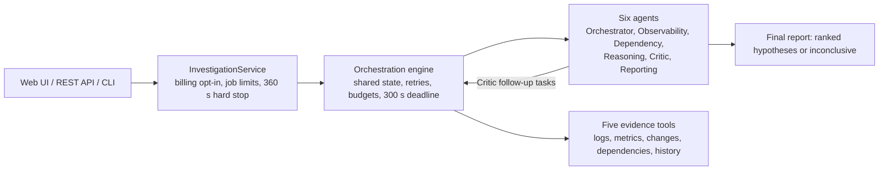

# Multi-Agent Production Incident Investigation System

A FastAPI service in which six collaborating AI agents investigate a production incident and produce ranked,
evidence-backed root-cause hypotheses, or an explicit **inconclusive** result when the evidence does not justify a
cause. Built for the Orange Invest AI Engineer assignment. All evidence is synthetic.

**Reviewer quick start:**
- Run `python -m pytest` (no key or network needed).
- Read [docs/ARCHITECTURE.md](docs/ARCHITECTURE.md#diagrams) for the diagrams, [docs/SRS.md](docs/SRS.md) for the
  requirements and their status, and [docs/TECHNICAL_NOTE.md](docs/TECHNICAL_NOTE.md) for the 500-word summary.

## 1. Objectives

When a service degrades, an engineer must collect logs, metrics, recent changes and dependency information, form
competing explanations, and decide which one the evidence actually supports. This project automates that
investigation with agents that:

- gather evidence only through structured, deterministic tools;
- separate facts from interpretations and assumptions;
- cite every claim to a retrieved record;
- are challenged by a critic before anything is concluded;
- stop within fixed limits, saying "inconclusive" rather than guessing.

## 2. Capabilities and limitations

**Implemented and tested offline (591 automated tests):**
- six agents on a bounded asyncio engine, with parallel tasks, task dependencies and a critic feedback loop;
- five evidence tools with typed queries and results, error handling and simulated failures;
- code-enforced grounding: citation checks, evidence classes, pre-incident metric baselines, timeline and
  evidence-independence checks, confidence caps, and an auditable adjudication;
- a single-agent baseline with the same tools and rules, and an evaluation harness over 10 labelled incidents;
- REST API, minimal web UI and CLI;
- a billing opt-in and a per-request input-token budget for real model calls.

**Limitations (details in [section 14](#14-known-limitations)):**
- Evidence is synthetic, with no authentication and in-memory jobs.
- **No real-model run has scored correct** against the answer key.
- There is **no real-model comparison** of the two approaches.

## 3. Architecture overview

Agents never call each other. Each agent is a task handler: the engine runs tasks once their dependencies finish,
and agents exchange typed results through the shared investigation state.



Full system, investigation-flow and agent-sequence diagrams: [docs/ARCHITECTURE.md](docs/ARCHITECTURE.md#diagrams).

## 4. Agents

| Agent | Responsibility |
|---|---|
| Orchestrator | Scopes the incident (time window, focus services, keywords; bounded in code) and plans the task graph |
| Observability | Turns logs and metrics into cited observations, with code-computed metric summaries |
| Dependency | Turns change history and service topology into cited findings |
| Reasoning | Proposes up to five competing, ranked hypotheses with supporting and contradicting evidence |
| Critic | Challenges the hypotheses, gives a verdict, and requests validated follow-up evidence (at most 2 rounds) |
| Reporting | Writes the final report; code then applies the report rules and the adjudication |

## 5. Evidence tools

| Tool | Purpose |
|---|---|
| `search_logs` | Log records by time window, service, level and keywords |
| `query_metrics` | Metric samples by time window, service and metric name |
| `get_change_history` | Deployments, config changes, feature flags and rollbacks |
| `get_service_dependencies` | Dependency edges around a service |
| `search_historical_incidents` | Past incidents by keywords and services |

Each tool returns records, completeness, warnings and typed errors, including simulated faults. Contracts are in
[docs/TOOLS.md](docs/TOOLS.md).

## 6. State, dependencies, feedback and termination

**Shared state and dependencies:**
- Every task, attempt and typed result lives in one investigation state (`app/orchestration/models.py`).
- Evidence tasks run in parallel (up to 5 at once).
- Observability waits for logs and metrics, and Dependency for changes and topology. Reasoning waits for both, and
  the Critic for Reasoning.

**Critic feedback loop:** a "revise" verdict adds validated follow-up evidence tasks and a new Reasoning and Critic
round, at most 2 rounds in all.

**Termination limits:** 2 attempts per task (retryable errors only), 40 tasks, 80 attempts, a 300 s deadline, and a
360 s hard stop per job. Reporting runs last, as a finalizer. If it can't, a deterministic **inconclusive**
fallback report is produced instead.

**Conclusions:** a cause is named only if every decision check passes. The failed checks are listed otherwise.
Details are in [docs/ARCHITECTURE.md](docs/ARCHITECTURE.md), "Termination controls".

## 7. Prerequisites

- Python **3.12 or newer** (developed and tested with 3.13.7); macOS or Linux shell, or Windows PowerShell.
- Runtime dependencies (`requirements.txt`): `fastapi`, `uvicorn[standard]`, `pydantic-settings`, and `openai`
  3.37 or newer.
- Test dependencies (`requirements-dev.txt`): `pytest`, `httpx`.
- **No database or external service.** An OpenAI API key is needed only for optional, billed real-model runs.

## 8. Setup (fresh checkout)

macOS / Linux, from the project root:

```zsh
python3 -m venv .venv
source .venv/bin/activate
python -m pip install --upgrade pip
python -m pip install -r requirements-dev.txt
cp .env.example .env          # optional; every setting has a safe default
```

Windows PowerShell (these steps mirror the above but have not been run on Windows):

```powershell
py -3.12 -m venv .venv
.\.venv\Scripts\Activate.ps1    # if blocked: Set-ExecutionPolicy -Scope Process -ExecutionPolicy Bypass
python -m pip install --upgrade pip
python -m pip install -r requirements-dev.txt
Copy-Item .env.example .env
```

`.env` is git-ignored. Never commit it, and never put a real key in `.env.example`.

## 9. Configuration

Settings are read from environment variables or `.env`; [.env.example](.env.example) documents every one. An
invalid value stops the server at startup and names the setting.

| Mode | Settings | What runs |
|---|---|---|
| **Offline (safe default for reviewing)** | `LLM_PROVIDER=offline-heuristic` | A keyless, deterministic rule-based stand-in. **Not an AI model**; every report says so |
| Real model (billed) | `LLM_PROVIDER=openai`, `LLM_MODEL`, `LLM_API_KEY`, **plus** `LLM_ALLOW_BILLED_CALLS=true` | The six agents on the model. Without the opt-in, the API returns `503` and the CLI exits with code 2 before any client is created |
| Unset | — | The server runs and `/health` works; submissions return `503` with instructions |

**Limits:**

| Setting | Default | Effect |
|---|---|---|
| `LLM_MAX_INPUT_TOKENS` | 64,000 | Larger requests are refused before sending |
| `LLM_MAX_OUTPUT_TOKENS` | 4,000 | Output cap per request |
| `LLM_TIMEOUT_SECONDS` | 120 | Per-request timeout |
| `AGENT_MAX_CRITIC_ROUNDS` | 2 | Critic rounds |
| `AGENT_MAX_EVIDENCE_REQUESTS` | 3 | Follow-up evidence requests per round |
| `INVESTIGATION_DEADLINE_SECONDS` | 300 | Investigation deadline |
| `API_MAX_ACTIVE_INVESTIGATIONS` | 2 | Jobs running at once |

Give the billing opt-in **on the command line for one command only**, never in `.env`.

## 10. Running

```zsh
python -m pytest                                                        # 591 tests; no key, no network
LLM_PROVIDER=offline-heuristic python -m uvicorn app.main:app --host 127.0.0.1 --port 8000
LLM_PROVIDER=offline-heuristic python -m app.cli --list                 # evidence sources and example incidents
LLM_PROVIDER=offline-heuristic python -m app.cli EVAL-07 --format markdown
LLM_PROVIDER=offline-heuristic python -m app.cli --incident-file examples/incident.json
python -m app.evaluation offline                                        # both approaches, all 10 cases
```

**Real model (billed):** set `LLM_PROVIDER=openai`, `LLM_MODEL` and `LLM_API_KEY` in `.env`, then run
`LLM_ALLOW_BILLED_CALLS=true python -m app.cli INC-2041`. To check the configuration without sending anything:

```zsh
python -c "from app.core.config import get_settings; from app.llm import check_llm_settings; check_llm_settings(get_settings(), billing_confirmed=True); print('configured')"
```

The CLI prints the elapsed time, model calls and token totals at the end. The live evaluation,
`python -m app.evaluation live --confirm-billed`, is implemented but has never been run.

## 11. UI and API

With the server running on port 8000:
- **Web UI:** http://127.0.0.1:8000/
- **Interactive API documentation:** http://127.0.0.1:8000/docs

```zsh
curl -s -X POST http://127.0.0.1:8000/investigations -H 'content-type: application/json' -d @examples/incident.json
curl -s http://127.0.0.1:8000/investigations/<investigation_id>              # queued | running | completed | failed
curl -s http://127.0.0.1:8000/investigations/<investigation_id>/report       # JSON (409 until completed)
curl -s http://127.0.0.1:8000/investigations/<investigation_id>/report.md    # Markdown
```

| Route | Purpose |
|---|---|
| `POST /investigations` | Submit an incident. Requires `summary` and a timezone-aware `reported_at`; `affected_services`, `severity`, `reporter`, `context` and `evidence_source` (default `demo`) are optional. Returns `202`; `422` invalid; `429` too many running (with `Retry-After`); `503` no usable model |
| `GET /investigations`, `GET /investigations/{id}` | Job list; status, outcome and model usage |
| `GET /investigations/{id}/report[?format=markdown]`, `GET /investigations/{id}/report.md` | The report, with every citation resolved to its record. `404` unknown; `409` not finished or failed |
| `GET /evidence-sources`, `GET /capabilities`, `GET /health` | Evidence worlds and example incidents; whether investigations can run; liveness |

## 12. Evaluation

**Method** ([docs/EVALUATION.md](docs/EVALUATION.md)):
- 10 labelled synthetic incidents ([data/eval/](data/eval/README.md)), including a misleading deployment,
  conflicting signals, missing metrics, a simulated tool failure, competing causes and insufficient evidence.
- Both approaches run with the same tools, budgets and rules. Labels are read only by the scorer, after every
  investigation has finished.
- Metrics: strict and lenient root-cause accuracy, confidently-wrong rate, top-1/top-3, citation existence and
  key-evidence recall, tool calls, model calls, latency and tokens.

**Offline results** ([evaluation_results/offline-heuristic/report.md](evaluation_results/offline-heuristic/report.md)):
- Both approaches score strict 0.4, lenient 0.6 and confidently wrong 0.0.
- They use a rule-based stand-in shared by both, so these scores test the harness. **They do not measure model
  accuracy or show that either approach is better.**

**Real-model results** ([docs/LIVE_RUN_EVAL01_ANALYSIS.md](docs/LIVE_RUN_EVAL01_ANALYSIS.md)):
- Four `gpt-4o-mini` runs of EVAL-01 (about $0.01–0.02 each), preserved with checksums in
  [artifacts/live-runs/](artifacts/live-runs/).
- **None scored correct** against the unchanged answer key: three were inconclusive, and one named only the
  mechanism.
- Run 4 used a Reasoning prompt example that revealed EVAL-01's answer (since removed, with a regression test), so
  it is not clean evidence of improvement.
- The later noise-floor fix and the leak-free prompt have not been run against a real model.
- There is no real-model multi-agent vs single-agent comparison.

## 13. Development record

The project was developed with Claude Code. The redacted conversation is in
[docs/AI_TRANSCRIPT.md](docs/AI_TRANSCRIPT.md); its header explains how it was exported and what it leaves out.

## 14. Known limitations

**Not implemented:**
- No authentication: keep the server on `127.0.0.1`.
- Jobs are kept in memory (the last 50) and are lost on restart.
- Only one process.
- Synthetic evidence only, with no real observability integrations.
- The web UI is deliberately minimal and loses track of a running job on reload. Use `GET /investigations` to find
  it again.

**Model-dependent:**
- Code checks what a citation is, not what it means, so the model can misfile evidence, as in run 4.
- Results vary from run to run.
- Live runs need network access and are billed.

**Not validated:**
- the live evaluation mode, which has never been run;
- the Windows setup steps;
- real-model behaviour of the most recent fixes.

More detail: [docs/ARCHITECTURE.md](docs/ARCHITECTURE.md), "Known limits", and [docs/SRS.md](docs/SRS.md), section 10.

## 15. Repository guide

| Path | Contents |
|---|---|
| `app/agents/` | the six agents, evidence references, grounding, timeline, independence, adjudication, report rules |
| `app/tools/` | the five evidence tools and fault injection |
| `app/orchestration/` | the engine: tasks, shared state, scheduling, retries, budgets |
| `app/baseline/` | the single-agent baseline |
| `app/evaluation/` | dataset loader and builder, offline stand-in, runner, metrics, report |
| `app/product/`, `app/api/`, `app/static/`, `app/cli.py` | service layer, REST API, web UI, CLI |
| `app/llm/` | model clients, billing opt-in, input-token budget |
| `data/eval/`, `data/fixtures/` | labelled evaluation incidents; shared demo fixtures |
| `tests/` | 591 automated tests |
| `evaluation_results/offline-heuristic/` | offline evaluation results |
| `artifacts/live-runs/` | the four real-model runs of EVAL-01, each with a README and `SHA256SUMS` |
| `docs/ARCHITECTURE.md` | diagrams, engine, agents, grounding, termination, known limits |
| `docs/SRS.md` | requirements, status and traceability |
| `docs/TOOLS.md`, `docs/EVALUATION.md` | tool contracts; evaluation method and metrics |
| `docs/LIVE_RUN_EVAL01_ANALYSIS.md` | analysis of the real-model runs |
| `docs/TECHNICAL_NOTE.md`, `docs/PRODUCT_AUDIT.md` | technical note; product audit |
| `docs/AI_TRANSCRIPT.md` | coding assistant transcript |

## 16. Deliverables checklist

| Assignment deliverable | Where |
|---|---|
| Runnable implementation and setup instructions | `app/`; sections 7–11 above |
| Architecture diagram and explanation | [docs/ARCHITECTURE.md](docs/ARCHITECTURE.md#diagrams): system, flow and sequence diagrams (Mermaid) |
| Synthetic dataset and automated tests | `data/eval/`, `data/fixtures/`; `tests/` (591 tests) |
| Evaluation results comparing both approaches | `evaluation_results/offline-heuristic/` (offline stand-in only; see section 12) and `docs/LIVE_RUN_EVAL01_ANALYSIS.md` |
| Technical note (≤ 500 words) | [docs/TECHNICAL_NOTE.md](docs/TECHNICAL_NOTE.md) |
| AI coding assistant transcript | [docs/AI_TRANSCRIPT.md](docs/AI_TRANSCRIPT.md) |
| Requirements and traceability | [docs/SRS.md](docs/SRS.md) |
