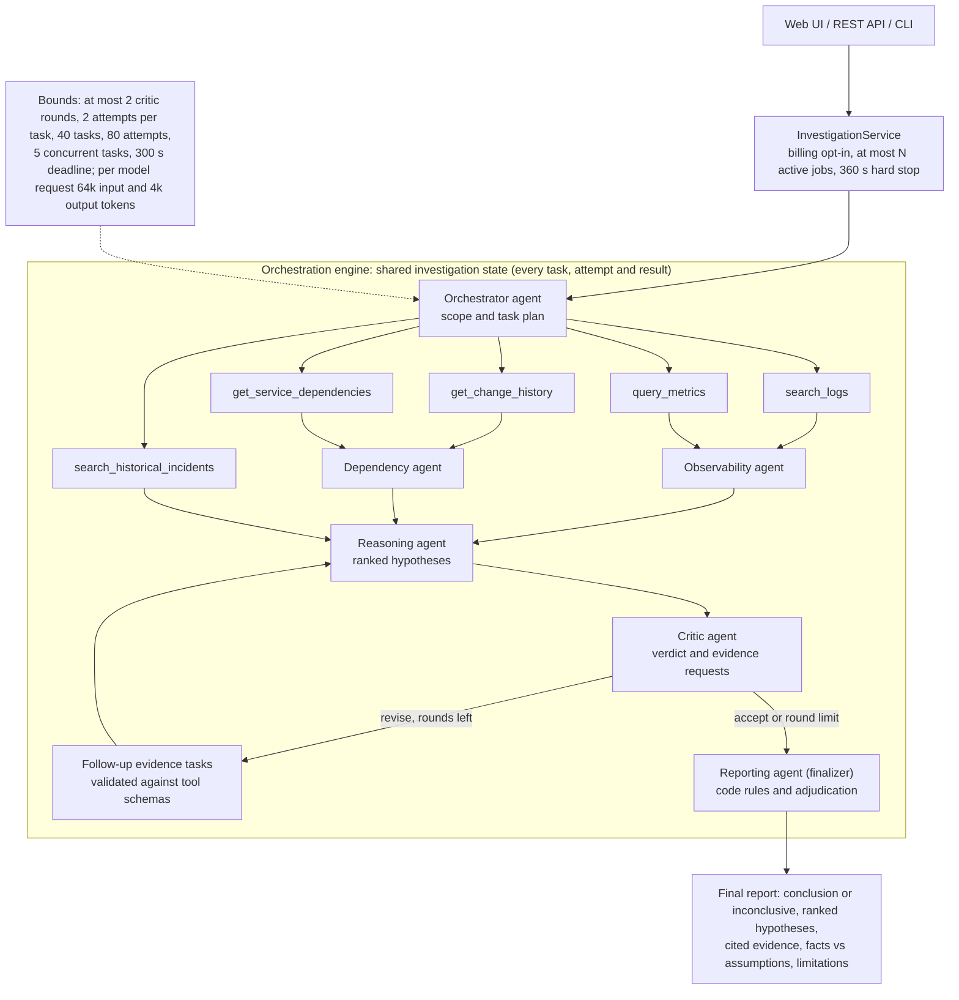

# Architecture

```
app/
  factory.py         create_app(settings=None); importing it has no side effects
  main.py            ASGI entry point: app = create_app(), so bad config fails at startup
  core/              settings (pydantic-settings, SecretStr) and logging
  api/routes/        HTTP routers; one module per resource
  schemas/           Pydantic models: incident report, evidence records,
                     tool queries, EvidenceResult envelope
  tools/             five deterministic evidence tools, fixture loader,
                     fault injection (see docs/TOOLS.md)
  orchestration/     investigation engine (Phase 2, described below)
    models.py        task specs, task/investigation state, transitions, evidence overview
    plan.py          InvestigationPlan and task-graph validation
    handlers.py      handler interface, EvidenceTaskHandler, evidence_task()
    engine.py        InvestigationEngine: scheduling, retries, timeouts, budgets, finalizers
  llm/               provider-neutral LLMClient, OpenAIClient, ScriptedLLMClient (tests)
  agents/            the six agents (Phase 3, described below)
    contracts.py     typed inputs/outputs of every agent
    evidence.py      evidence references and their validation (RefIndex)
    base.py          LLMAgent: call model, validate, check, fall back, store envelope
    orchestrator.py  scope + plan + budgets; investigate() entry point
    observability.py, dependency.py, reasoning.py, critic.py, reporting.py
  product/           product layer (Phase 5), reusing OrchestratorAgent unchanged:
    sources.py       evidence worlds a user can investigate against (demo + EVAL-NN inputs; never labels)
    service.py       in-memory background jobs: concurrency cap, hard time limit, bounded storage
    report_view.py   user-facing report: every citation resolved to the retrieved record; Markdown
  api/routes/        health; investigations (POST/GET jobs, report JSON/Markdown, sources, capabilities); ui
  static/index.html  minimal web UI (no build step, no external assets; data inserted as text only)
  baseline/          single-agent baseline (Phase 4): one model, same tools/rules, tool-calling loop
  evaluation/        dataset builder/loader, heuristic offline model, runner, metrics, report (Phase 4;
                     see docs/EVALUATION.md); `python -m app.evaluation offline|live`
  cli.py             python -m app.cli INC-2041  (live run; needs LLM settings)
  core/redaction.py  credential redaction for stored/logged error text
tests/               pytest suite
data/fixtures/       synthetic JSONL evidence shared by all phases (see data/README.md)
docs/                design notes
```

## Conventions

- Configuration comes only from environment variables / `.env`, read through
  `app.core.config.get_settings()`. Routes receive settings via FastAPI `Depends`,
  so tests override them with `app.dependency_overrides`.
- Secrets are `SecretStr`: masked in `repr`/logs and never returned by any endpoint.
- Evidence tools return `EvidenceResult` and never raise for expected failures.
  They report what was observed and how complete it is, not what it means.
- No agent or orchestration framework is used; the engine is plain `asyncio` + Pydantic.
  The only model SDK is the official `openai` package, used only inside `app/llm/openai_client.py`.

## Orchestration engine

The engine runs an **investigation plan**: a set of tasks with declared dependencies.
It knows nothing about LLMs. Each task has a `kind`, and the engine calls the
**handler** registered for that kind. Phase 1's evidence tools run through the
`evidence` handler, and the Phase 3 agents will be further handler kinds.

```python
import asyncio
from app.orchestration import (EVIDENCE_TASK_KIND, EvidenceTaskHandler, InvestigationEngine,
                               InvestigationPlan, evidence_task)
from app.schemas.incident import IncidentReport
from app.tools import build_evidence_tools

incident = IncidentReport(incident_id="INC-2041", summary="Checkout card payments failing")
window = {"start": "2026-10-20T13:30:00Z", "end": "2026-10-20T15:00:00Z"}
plan = InvestigationPlan(tasks=[
    evidence_task("logs", "search_logs", {**window, "services": ["payments-api"]}),
    evidence_task("changes", "get_change_history", {**window, "services": ["payments-api"]}),
    evidence_task("history", "search_historical_incidents",
                  {"services": ["payments-api"]}, depends_on=["changes"]),
])
engine = InvestigationEngine({EVIDENCE_TASK_KIND: EvidenceTaskHandler(build_evidence_tools())})
investigation = asyncio.run(engine.run(incident, plan))
investigation.status, investigation.termination_reason, investigation.evidence
```

### Building blocks

| Concept | Model | Notes |
|---|---|---|
| Task definition | `TaskSpec` (immutable) | `task_id`, `kind`, `depends_on`, `inputs`, `retry` (`max_attempts` 1–5, optional backoff), `timeout_seconds` per attempt, `dependency_policy`, `required` |
| Plan | `InvestigationPlan` | Rejects duplicate IDs, unknown dependencies, self-dependencies and cycles (the error names the cycle path) |
| Handler | `async (TaskContext) -> TaskOutput` | Context: incident, task spec, attempt number, **copies** of finished dependency records. Raises `TaskFailure(TaskError)` for a classified failure. |
| Task state | `TaskRecord` | Status, every `TaskAttempt` (timing, outcome, error, evidence), final output or error, `blocked_by`, `added_by` |
| Investigation | `Investigation` | Incident, limits, ordered tasks, event log, attempts used, status, termination reason, computed `evidence` overview |
| Limits | `EngineLimits` | `max_tasks` (25), `max_total_attempts` (60), `max_concurrency` (5), `deadline_seconds` (120) |

### Task lifecycle

```
PENDING ──► RUNNING ──► SUCCEEDED
   │           ├──────► FAILED       (non-retryable error, or retries/attempt budget used up)
   │           └──────► CANCELLED    (deadline exceeded or investigation cancelled mid-attempt)
   ├──────► BLOCKED                  (a dependency did not succeed; REQUIRE_SUCCESS policy)
   └──────► SKIPPED                  (never started: attempt budget, deadline or cancellation)
```

Every other transition raises `InvalidTransitionError`. Terminal states are final,
so a task can never run twice. Every non-successful terminal state carries a
`TaskError` that says why. The model validators enforce the same invariants when
state is built from data.

**Dependency policies.** `require_success` (default): the task runs only if every
dependency succeeded; otherwise it is BLOCKED as soon as one dependency fails.
`allow_failures`: the task runs once every dependency has finished, whatever the
outcome. It is meant for steps such as a summariser that must report what failed.

### Execution

1. `execute()` moves the investigation PENDING → RUNNING. It can only be executed once.
2. The scheduler resolves pending tasks in plan order. It blocks tasks whose
   required dependencies failed, skips tasks once the attempt budget is spent, and
   starts ready tasks as separate asyncio tasks, up to `max_concurrency`. Independent
   tasks therefore run concurrently. Evidence tools are synchronous and run via
   `asyncio.to_thread`, so they overlap too.
3. Each attempt runs under `asyncio.timeout(timeout_seconds)`. Errors are classified:

   | Failure | Code | Retried? |
   |---|---|---|
   | `TaskFailure` with `retryable=True` (e.g. tool `unavailable`/`timeout`) | as given | yes |
   | `TaskFailure` with `retryable=False` (e.g. `invalid_query`, `data_unavailable`, `invalid_input`) | as given | no |
   | attempt exceeded `timeout_seconds` | `timeout` | yes |
   | model timeout / rate limit / unavailable / invalid output (agents) | `model_*` | yes |
   | model rejected the request (auth, 4xx) | `model_rejected` | no |
   | any other exception, or a return value that isn't a `TaskOutput` | `handler_error` (message redacted) | no (treated as a bug) |
   | invalid follow-up tasks | `invalid_follow_up` | no |

   Retries stop at the task's `max_attempts` or when the investigation's
   `max_total_attempts` is used up, whichever comes first. Every attempt is recorded.
4. A handler may return `follow_up_tasks`; the critic loop uses this. They are validated
   against the current graph and added with `added_by` set. If adding them would exceed
   `max_tasks`, they are rejected and logged, which stops runaway loops.
   A task with `finalizer=True` starts only after every non-finalizer task has finished,
   including follow-ups added later, and gets copies of all tasks in `TaskContext.all_tasks`.
   No task may depend on a finalizer. A finalizer still counts against budgets and is SKIPPED
   if the deadline or attempt budget runs out first.
5. When nothing is running and nothing can start, the investigation finishes.
   If the deadline passes, running tasks are cancelled (CANCELLED) and unstarted ones
   skipped (SKIPPED). External cancellation does the same, then re-raises
   `CancelledError`. Every task always ends in a terminal state.

### Final status

Checked in this order:

| Condition | Status | `termination_reason` |
|---|---|---|
| Cancelled from outside | `cancelled` | `cancelled` |
| Deadline, attempt budget or task budget hit | `partially_completed`, or `failed` if nothing succeeded or a `required` task did not | `deadline_exceeded` / `attempt_budget_exhausted` / `task_budget_exhausted` |
| Every task succeeded | `completed` | `all_tasks_succeeded` |
| A `required` task did not succeed | `failed` | `required_task_did_not_succeed` |
| No task succeeded | `failed` | `no_task_succeeded` |
| Otherwise | `partially_completed` | `some_tasks_did_not_succeed` |

### Evidence quality vs task success

Task status says whether a tool **ran**. Evidence quality is reported separately in
`investigation.evidence` (one `EvidenceRef` per evidence task):

| `outcome` | Meaning |
|---|---|
| `collected` | Tool ran over complete data and returned records |
| `no_matches` | Tool ran over complete data and found nothing. This is not proof the event did not happen. |
| `partial` | Tool ran but data was missing, unreadable or truncated (see the result's warnings) |
| `failed` | Tool was called and failed; no evidence was obtained |
| `not_collected` | Tool was never run successfully (blocked, skipped or cancelled) |

A failed or skipped task never gets an output, so the engine cannot invent evidence.
Failed attempts keep the tool's failed `EvidenceResult`, including the `simulated`
flag, for provenance. A successful task's output holds the full `EvidenceResult`,
with the exact query, records, completeness and warnings.

### Known limits

- The investigation state lives in memory. It serialises to JSON, but loading it
  back from JSON is not supported, because evidence records are not re-typed on load.
- A timed-out or cancelled evidence tool's worker thread **still finishes in the background**;
  Phase 3 does not change this. It is harmless for the local fixtures. Agents use the
  SDK's async client, so cancelling an agent task does cancel its HTTP request.

### Known limits of grounding and decision rules (Phases 6–7)

- **Semantic grounding is model-dependent.** Code checks structure: the reference exists, its evidence class,
  whether a flat metric supports a claimed increase, and timing. Whether a log line actually supports a specific
  causal claim is left to the Reasoning and Critic models.
- **Metric threshold.** A metric sample is "changed" if it deviates from its pre-onset baseline by at least
  max(25%, 3 × noise). Changes below 25% never count. The 25% and 3× values are fixed choices, not tuned.
- **Metric baseline.**
  - The onset is estimated without metrics: the first ERROR-log episode (two or more errors within 30 min) on
    the incident's affected services, or on any service if none are listed, capped at the reported time.
    A lone error is not an episode.
  - If an incident is reported long after it began and no error logs date it, the baseline can still include
    incident samples. The median tolerates a minority of them.
  - An earlier error episode on an affected service, even an unrelated one, moves the onset early. That can
    leave too few samples, so the metric becomes "insufficient baseline": its evidence is lost, but it is never
    misread as normal.
  - The metric summaries shown to the Observability model are built from `ev.logs` and `ev.metrics` only. The
    final report also sees the critic's follow-up queries, so its onset estimate, and so a metric's class, can
    differ from what the model was shown.
  - Only the planned `ev.metrics` query is widened to include a baseline; the critic's follow-up metric queries
    are not. The single-agent baseline widens every metric query, so the two differ only if `ev.metrics` fails.
    Its widened queries can also coincide, and a second one is then rejected as "the same query was already run".
  - The widened metric query has no upper bound beyond the scope rules: it can span about 9 hours. At the tool's
    record limit, whole series are dropped in service/metric order and the result is marked partial.
- **Keyword heuristics.** These are fixed phrase lists, so paraphrases can slip through:
  - spotting "increase" claims, used to move a flat metric to contradicting. An increase word negated within the
    4 preceding words of its clause ("did not rise", "no increase") is not a claim; "not only" and "no doubt" are
    not negations. The nouns "load", "traffic" and "volume" count as claims by themselves, so "load did not
    increase" still does. A flat metric is never counted as support, even for a claim that denies an increase;
  - spotting "missing evidence" claims;
  - spotting causal wording in facts. "Indicate" counts as inferential unless an evidence noun (logs, errors,
    messages, records, metrics…) comes within the 5 preceding words of its clause, as in "the logs indicate
    timeouts". So an inference phrased that way ("the errors indicate a connection leak") stays a fact;
  - spotting a model limitation that restates the critic round limit, which is dropped when code already states
    it. Other duplicates are removed only when the wording is identical.
- **Rules added after live runs 3 and 4:**
  - **The top hypothesis names its cited change.** If it cites a change record as direct support that the timeline
    does not rule out, and its title names that change by neither id nor summary, code appends the change's id,
    summary and recorded old → new value. This changes wording only, not the decision.
  - **Load claims.** A claim of increased load or traffic cannot rest on symptom metrics (latency, errors) when every
    request-rate sample shows no change. Request-rate metrics are recognised by name (request, rps, throughput,
    traffic) on any service. With no request-rate data, the rule does nothing.
  - **Noise floor.** The smallest-step noise floor uses only the middle half of the baseline, so one boundary sample
    that already shows the incident cannot hide a change.
- **Model citation errors are not corrected.** Code checks what a citation *is* (its class, timing and source), not
  what it *means*. In run 4 the model filed log lines that support its leading hypothesis as evidence against it, and
  the adjudication stayed inconclusive.
- **Timeline checks.**
  - The tolerances are fixed: ±60 s, a 5-minute rollback settle period, and 25% for "worsened".
  - Delayed-effect changes aren't modelled.
  - Only ERROR/CRITICAL logs and metric anomalies count as symptoms.
  - A concurrent, unrelated incident on the same service can still set an early onset if it forms an episode.
    A single stray error does not.
  - A rollback that doesn't record what it reverted is never used to exclude a change.
  - Missing or ambiguous timestamps never block a hypothesis.
- **Evidence independence.**
  - Different sources (logs, metrics, change history) are treated as independent by provenance.
  - Correlation between metrics of the same service isn't modelled.
  - A change's echo in the logs is detected only through its exact ID, version or config key.
  - Several observations from one source are "unknown", never independent.
- **Decision policy.** "Material contradiction" (direct counter-evidence spanning at least as many sources as
  the support) is a policy choice. So is the requirement of two independent sources.
- **Verification.** gpt-4o-mini runs 2–4 of EVAL-01 exercised these rules, the evidence classes, timeline and
  independence checks, the evidence inventory, facts vs interpretations and the adjudication, but only on one case.
  - The pre-onset metric baseline ran in runs 3 and 4; its widened fetch was needed only in run 4.
  - The duplicate round-limit rule acted in runs 3 and 4.
  - The title rule and the load rule were active in run 4. The title rule did not need to act, and the saved report
    does not record whether the load rule acted.
  - The noise-floor fix and the leak-free Reasoning prompt have no real-model run.

## Agents (Phase 3)

Six agents, each a task handler on the engine. They communicate only through typed task
results in the shared investigation state; no agent calls another directly.

| Agent | Task(s) | Reads | Produces |
|---|---|---|---|
| **Orchestrator** | `orchestrate` | incident report | `InvestigationScope` (window, focus services, keywords), then the whole task graph as follow-ups; sets every budget |
| **Observability** | `observability` | `ev.logs`, `ev.metrics` | observations (`obs-N`, each `fact` or `interpretation`, cited), onset estimate, plus code-computed metric summaries and data gaps |
| **Dependency** | `dependency` | `ev.changes`, `ev.deps.<service>` | findings (`dep-N`, cited), plus code-computed change relations (minutes before report; relation to focus services through the dependency graph) |
| **Reasoning** | `reasoning.r1`, `reasoning.r2`, … | both agents' findings, all evidence, previous hypotheses, critique, new evidence | up to 5 competing hypotheses with supporting/contradicting refs, missing information, confidence |
| **Critic** | `critic.r1`, `critic.r2`, … | the hypotheses and everything Reasoning saw | issues, verdict, and validated evidence requests that become follow-up tasks |
| **Reporting** | `report` (finalizer) | the whole final state | `FinalReport`: conclusion or *inconclusive*, ranked hypotheses, facts vs assumptions, limitations, corrective actions |

The **evidence tools** run as `evidence` tasks (`ev.*`). The model never calls tools, shell or
code. It can only *request* a query through the Critic, and code validates that request against
the registered tool's query schema before scheduling it. Each request is judged on its own:
- An unknown tool, an unknown hypothesis, invalid JSON or a schema-invalid query is rejected with a
  recorded reason, as is a query already run (earlier or in the same response) or one over the
  per-round limit.
- Valid requests from the same response still run.
- The tool name's JSON schema carries an enum of the registered tools, so strict structured output
  already constrains it. The per-request check is the second line of defence.

### Data flow and feedback loop

Overview (Mermaid; the text figure below shows the same flow as tasks):



```
orchestrate ─► ev.logs, ev.metrics ─────────► observability ─┐
            ├► ev.changes, ev.deps.<svc> ───► dependency ─────┼─► reasoning.r1 ─► critic.r1
            └► ev.history ────────────────────────────────────┘                    │
                                                                                    │ verdict revise/insufficient
              ┌─────────────────────────────────────────────────────────────────────┘ and rounds remain
              ▼
       ev.c1.1 … (validated requests) ─► reasoning.r2 (sees critique + new evidence) ─► critic.r2 ─► …

report (finalizer) ─ runs after everything above has finished, whatever the outcome
```

Example (fixtures, scripted model): `critic.r1` judged H1's "high" confidence unjustified while
fraud-check metrics were missing. It requested `search_logs` for "config reloaded", which became
`ev.c1.1`. `reasoning.r2` cited the new record `ev.c1.1#0` (the pool change took effect at 13:55:20)
and lowered H1 to medium. `critic.r2` accepted, and the report named H1 as the probable cause at
medium confidence, with H2 still open.

### Evidence references and grounding

References are `"<task>"` (a whole result; cite it for gaps), `"<task>#<n>"` (a tool record)
and `"<task>/<finding-id>"` (an agent finding, which itself cites records). After schema
validation, every agent's output is checked in code:

- every reference must be one the agent was shown; invented references are rejected (retryable).
  Short references are handled narrowly:
  - A bare finding id ("dep-3") is rewritten to its full form ("dependency/dep-3") only if exactly
    one finding shown to that agent has that id. Each rewrite is recorded in `adjustments`.
  - Ambiguous ids, record references (`#n`) and anything else are never guessed; they are rejected
    as before. Ambiguous ones get a specific message.
  - The prompt also asks for the full form. The first live run produced `dep-3` and paid for a retry.
- a failed or never-collected result can't be cited as support or contradiction, and an
  observation labelled `fact` can't rest on one;
- every cited reference has an **evidence class** (`app/agents/evidence.py`, Phase 6):
  - *direct*: a log line, a change record, or a metric sample that deviates from its series' baseline by
    at least max(25% of the baseline, 3 × the baseline noise). The baseline is the median of the samples taken
    before the estimated onset (the first ERROR-log episode on the affected services, capped at the reported
    time; see "Known limits"); fewer than 3 such
    samples is an *insufficient baseline* (contextual), never "no change". Metric queries start at least 60 min
    before the reported time so a baseline exists, and the metric summaries shown to the model use the same
    baseline. The noise is the scaled median absolute deviation, but never below the smallest step
    between distinct values (Phase 7). Jitter on a tiny baseline, such as an error rate alternating 0.2% / 0.3%,
    is therefore not a change;
  - *contextual*: a dependency edge (a relationship, not a failure), a past incident, an interpretation,
    or a whole result;
  - *no_change*: a metric within its normal range;
  - *missing*: a failed or never-run query.
- **citation checks** (`app/agents/grounding.py`): a *no_change* metric cited as support is removed. If the
  hypothesis claims an increase, it is moved to contradicting instead, because a flat request rate cannot
  support "increased load". The trigger is a fixed keyword list, so this part is a heuristic.
- reasoning confidence is **capped by code**: no direct evidence → low, so topology or history alone can't
  carry a hypothesis; high needs direct support from ≥2 independent sources and nothing contradicting it;
  insufficient evidence → all low;
- the Critic adds rule-based issues (no direct support, absence used as support) that the model can't
  overrule. An "accept" with rule issues becomes "revise";
- the **evidence inventory** (`app/agents/inventory.py`) records, from tool outcomes only, what was
  retrieved, partial, matched nothing, failed, timed out or never ran. The report's limitations are the
  inventory's genuine gaps plus model claims that survive validation. "X was unavailable" is removed when
  X was retrieved;
- **evidence independence** (`app/agents/independence.py`, Phase 7): direct evidence is grouped into
  observations before anything is counted. These merge into one observation:
  - identical records retrieved by different queries;
  - log lines sharing a `trace_id`;
  - a log line naming a change's ID, version (optionally `v`-prefixed) or config key. "Config reloaded:
    db.pool.max_size=8" is an echo of that change, not corroboration of it.

  Corroboration ("independent") needs observations from ≥ 2 different evidence sources. Several observations
  from one source are reported as independence **unknown**, never assumed;
- **timeline checks** (`app/agents/temporal.py`, Phase 7): for each hypothesis that cites a change, the first
  symptom is compared with each change as UTC instants, never as strings. A symptom is an ERROR/CRITICAL log or
  an anomalous metric on the cited and affected services, and a metric only bounds onset to its sampling
  interval.

  Onset is the first symptom of an **episode**: one followed by another symptom within 30 minutes. Isolated
  earlier symptoms, such as a stray error an hour before, are named but not used (Phase 9). If every symptom
  is isolated, no onset is established.

  Each change is classed as:
  - *precedes onset*;
  - *follows onset*: it can't explain the onset. It "may have worsened" the incident only if a symptom metric
    rose ≥ 25% above its pre-change peak afterwards;
  - *ambiguous*: within ±60 s or the sampling interval;
  - *unknown*: the timestamp is missing, invalid or has no timezone;
  - *persisted after rollback*: a later successful rollback that **demonstrably reverted this change** was
    followed by symptoms more than 5 minutes later. "Demonstrably" means its `previous_version` is the change's
    version, or it names the change's ID or version. A rollback of some other change never excludes this one
    (Phase 9).

  A hypothesis whose cited changes all follow onset or persisted after rollback is capped to low and blocked
  as the cause. Unknown or ambiguous timing never discards a hypothesis. The report shows a "Timeline checks"
  section and explains each blocked change;
- the **adjudication** (`app/agents/adjudication.py`) decides whether a cause may be named. It does not
  take the critic's last verdict as the decision. It names a cause only when every listed check passes:
  - a review completed;
  - the leader is at least medium and strictly ahead;
  - the leader's direct support is independently corroborated;
  - its cited change is consistent with the onset timing;
  - there is no material direct contradiction;
  - no alternative has comparable direct support;
  - every requested follow-up was obtained.

  Critic issues that cite no direct evidence are reported as unresolved but don't block on their own.
  Deterministic (fallback or rules) reports never name a cause. The report shows every check, PASS or FAIL;
- **report rules** (`app/agents/report_rules.py`, shared with the baseline):
  - the adjudication sets the conclusion;
  - report confidences can't exceed the reasoning's;
  - facts with causal or inferential language move to *interpretations*, and uncited facts move to
    assumptions;
  - if the model lists no assumptions while a causal hypothesis exists, the causal-link premise is
    added, marked "(added by code)";
  - `would_confirm` and `would_disconfirm` hold the evidence that would settle the leading hypothesis.

Every adjustment code makes is recorded in the task's `adjustments`, so you can see what the
model said and what was accepted.

### Termination controls

| Control | Default | Where |
|---|---|---|
| Critic rounds | 2 (`AGENT_MAX_CRITIC_ROUNDS`) | Critic stops requesting once `round == max_rounds` |
| Evidence requests per round | 3 (`AGENT_MAX_EVIDENCE_REQUESTS`) | excess, invalid or repeated queries are rejected and recorded |
| Tasks per investigation | 40 | engine `max_tasks`; follow-ups beyond it are rejected |
| Model/tool attempts in total | 80 | engine `max_total_attempts` |
| Attempts per agent / evidence task | 2 / 2 | `RetryPolicy`; only transient errors are retried |
| Model request timeout | 120 s (`LLM_TIMEOUT_SECONDS`) | SDK, per request; ends as a retryable `model_timeout` |
| Agent task timeout | `LLM_TIMEOUT_SECONDS` + 30 s | engine per-attempt backstop; always longer than the SDK timeout |
| Deadline must fit one attempt | `INVESTIGATION_DEADLINE_SECONDS` ≥ `LLM_TIMEOUT_SECONDS` + 30 | checked by `AgentConfig.from_settings`; the CLI exits 2 if not |
| Deadline | 300 s (`INVESTIGATION_DEADLINE_SECONDS`) | engine; running tasks cancelled, rest skipped |

A report always exists:
- If the reporting model fails on its last attempt, a deterministic, *inconclusive* report is built
  from the state.
- If the report task never ran (deadline or budget), `investigate()` builds the same fallback report.
- Orchestrator scoping falls back to a fixed window around the reported time.
- Observability, Dependency and Reasoning skip the model and say so when they have no evidence at all.

### Model provider

`app/llm/openai_client.py` calls `AsyncOpenAI().responses.parse(model, instructions, input,
text_format=<output model>, max_output_tokens)`, then validates the returned text against the
output model itself.
- SDK retries are off (`max_retries=0`), so the engine is the only, bounded place where retries happen.
- Each request is checked against an input-token budget (`LLM_MAX_INPUT_TOKENS`, default 64,000) before it is
  sent. The tokenizer is byte-level, so a token covers at least one UTF-8 byte and our instructions and input
  are never more tokens than bytes. The output schema counts twice and 1,000 tokens are allowed for framing:
  these two allowances are estimates of how the provider renders a request, not measurements. A request over
  the budget is refused unsent, as a non-retryable `rejected` error. Each sent call logs its bound next to the
  input tokens the provider reports.
- Provider exceptions are mapped to fixed messages (kind and HTTP status only). Their text, which can
  echo partly masked keys, is never stored, logged or chained.
- Engine-level `handler_error` messages pass through `app.core.redaction.redact`.
- The API key is read only from `LLM_API_KEY` (a `SecretStr`) in `build_llm_client`.
- The model name comes only from `LLM_MODEL`.

Agents depend only on the `LLMClient` protocol. Tests use `ScriptedLLMClient`, which validates
scripted responses exactly like real output.

The SDK validates the model's text against the output model inside `responses.parse`. A
`pydantic.ValidationError` raised there is mapped to a retryable `invalid_output`, the same as
our own validation. `OpenAIClient.calls` records each call's agent, outcome, latency and token
usage (no content), and the CLI prints these totals.

**Live verification status: five completed billed runs, all with `gpt-4o-mini` and SDK 3.37.0** (and one cancelled
submission). The first was one run of
`python -m app.cli INC-2041`:
- 9 model calls, all HTTP 200, with all six output schemas accepted as strict structured output.
- The investigation `completed` in 104 s and 17 attempts, using 55,052 input and 5,743 output tokens.
- One grounding retry: Reasoning cited `dep-3` instead of `dependency/dep-3`. The check rejected
  it and the retry passed.
- The critic loop ran 2 rounds and executed 3 valid evidence requests.
- The report was **inconclusive** with five low-confidence hypotheses. The final critic verdict was
  still "revise" when the round limit was reached.

The second was one run of EVAL-01 through the product API (2026-10-27): 9 model calls, 53,390 input and 5,493
output tokens, 67.7 s, inconclusive with the correct cause ranked first. Its outputs are preserved byte for byte in
`artifacts/live-runs/EVAL-01/` and analysed in `docs/LIVE_RUN_EVAL01_ANALYSIS.md`.

The third was a second run of EVAL-01 through the API, from commit `9abc762` (2026-10-27): 8 model calls, 43,859
input and 3,989 output tokens, 55.9 s. The live API accepted the extended report schema and the report was
model-written, but it was again inconclusive with the correct cause ranked first. Outputs are in
`artifacts/live-runs/EVAL-01-run2/`.

Runs 3 and 4 of EVAL-01 (`artifacts/live-runs/EVAL-01-run3/`, `-run4/`) followed further fixes:
- **Run 3** concluded with all decision checks passing, but its top hypothesis named only the mechanism, so the
  answer key scores it a wrong conclusion.
- **Run 4** named the cause but stayed inconclusive, because the model cited the timeout logs against it. Its
  Reasoning prompt contained an example that mirrored EVAL-01's answer (since replaced), so its naming of the cause is
  not clean evidence.

All five runs verify the integration; none is a measurement of reasoning quality, and no EVAL-01 run has scored
correct. See `docs/LIVE_RUN_EVAL01_ANALYSIS.md`.
